# ChoicePie 架構文件

> 讀者：新加入的工程師（也適合當 AI agent 的專案上下文）。
> 內容以**實際程式碼**為準；與 `README.md`、`choicepie-backend/docs/backend-spec.md` 有出入的地方，列在 [known-risks.md](./known-risks.md)。
> 最後對照的 commit：`275be17`（develop）。

## 目錄

1. [系統概觀](#1-系統概觀)
2. [部署拓樸與執行時元件](#2-部署拓樸與執行時元件)
3. [後端架構](#3-後端架構)
4. [前端與 BFF 架構](#4-前端與-bff-架構)
5. [關鍵流程](#5-關鍵流程)
   - 5.1 REST 請求生命週期
   - 5.2 認證與 Token 輪替
   - 5.3 即時遊戲完整流程
   - 5.4 GameRoom 狀態機
   - 5.5 斷線重連
   - 5.6 AI 出題
   - 5.7 Domain Event 與 Transactional Outbox
   - 5.8 快取讀取與失效
6. [資料儲存](#6-資料儲存)
7. [橫切關注點](#7-橫切關注點)
8. [測試與 CI](#8-測試與-ci)
9. [程式碼導覽速查](#9-程式碼導覽速查)

---

## 1. 系統概觀

ChoicePie 是**即時多人問答遊戲**（類 Kahoot）加上**題庫社群**的產品。

| 角色 | 是否需登入 | 做什麼 |
|---|---|---|
| Host（主持人） | 需要（Member） | 建立題庫（手動 / AI）、開房、控制遊戲節奏 |
| Player（玩家） | 不需要 | 輸入 6 碼房號 + 暱稱，用手機作答 |
| Bigscreen（大螢幕） | 不需要 | 投影用旁觀畫面，只看不玩 |
| Member（一般會員） | 需要 | 瀏覽 / 收藏 / 留言 / 檢舉題庫、單人作答、追蹤創作者 |
| Admin（管理員） | 需要（獨立帳號體系） | 會員停權、題庫下架、檢舉處理、會員方案（AI 額度） |

### C4 Level 1：System Context

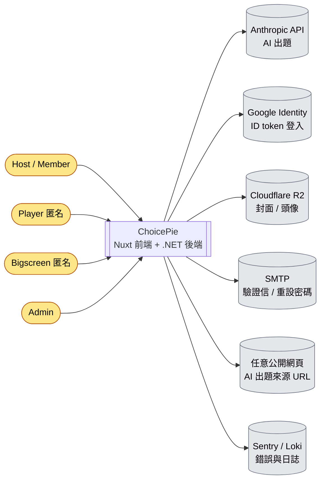

### C4 Level 2：Container

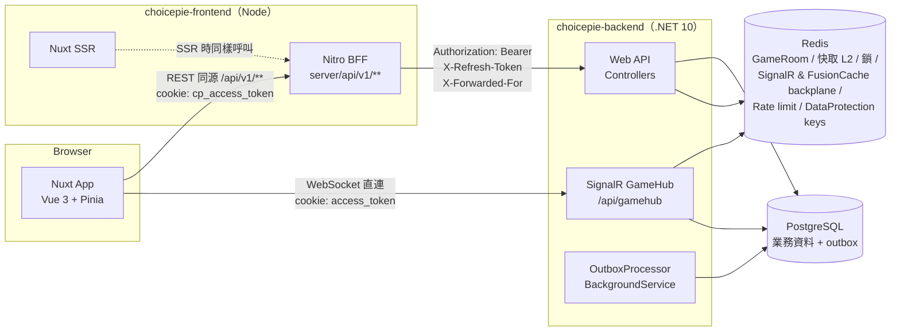

重點：

- **REST 一律經過 BFF**：瀏覽器只打同源 `/api/v1/**`，由 Nitro 讀 httpOnly session cookie，轉成 `Authorization: Bearer` 呼叫後端。
- **SignalR 直連後端**：WebSocket-only + `skipNegotiation`，用的是**後端自己發的** `access_token` cookie，不是 BFF 的 cookie（見 5.2）。
- **即時房間狀態只在 Redis**；遊戲結束時寫成 PostgreSQL 的 `GameSession` 歷史紀錄。
- 後端設計成**可水平擴展**：分散式鎖、SignalR Redis backplane、FusionCache backplane、Redis 速率限制、共用 DataProtection 金鑰、outbox `SKIP LOCKED`、啟動時 migration 用 advisory lock。

---

## 2. 部署拓樸與執行時元件

repo 內唯一完整描述多節點部署的是 `e2e/compose.yaml`（E2E 測試用的「類正式」環境）：

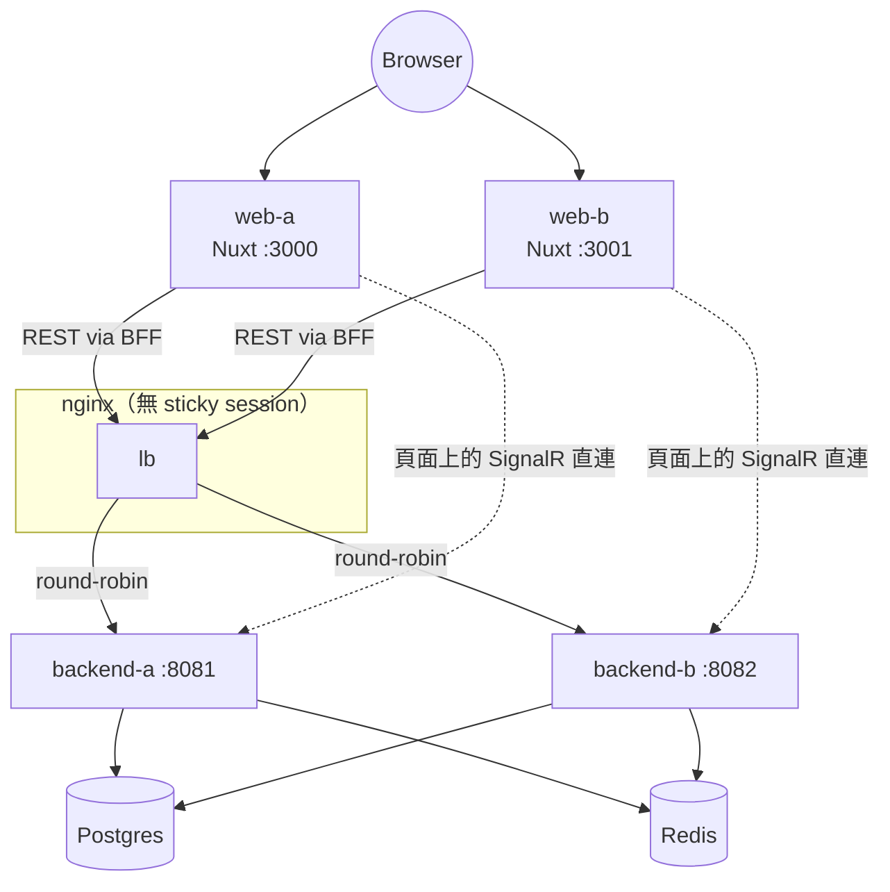

E2E 刻意讓 Host 與 Player 落在**不同後端節點**，以驗證 Redis backplane 與分散式鎖。

後端單一 process 內的元件：

| 元件 | 位置 | 說明 |
|---|---|---|
| ASP.NET Core pipeline | `WebApi/Program.cs` | ForwardedHeaders → RequestLogging → ExceptionHandler → HttpsRedirection（`/health` 除外）→ Routing → CORS → AuthN → AuthZ → RateLimiter → Controllers / Hub |
| GameHub | `WebApi/Hubs/GameHub.cs` | 即時遊戲入口，所有動作轉成 MediatR 命令 |
| OutboxProcessor | `Shared.Infrastructure.Persistence/Outbox/OutboxProcessor.cs` | 每台都跑，每秒輪詢 outbox |
| 啟動 migration / seeder | `Program.cs` | PostgreSQL advisory lock 包住 `MigrateAsync()` + `IDataSeeder`（例如建立第一位管理員） |
| Health checks | `/health/live`、`/health/ready` | ready 會檢查 Postgres 與分散式快取 |

---

## 3. 後端架構

技術：.NET 10 / C# 14、**Clean Architecture + DDD + CQRS（MediatR）+ Domain Events + Transactional Outbox**、EF Core（Npgsql）、FusionCache（以 `HybridCache` 介面使用）、Serilog、Sentry、Scalar/OpenAPI。

### 3.1 專案相依方向

以下依 `.csproj` 的 `ProjectReference` 繪製：

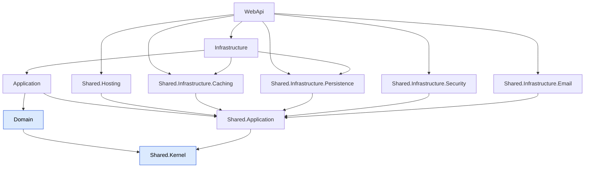

| 專案 | 職責 |
|---|---|
| `Shared.Kernel` | `AggregateRoot`、`Entity`、`ValueObject`、`Enumeration`、`Specification`、`BaseDomainEvent`、`IRepository`/`IUnitOfWork`、DI marker（`IScopedDependency` 等）、設定類別、共用 VO（`Email`、`HashedPassword`、`PersonName`） |
| `Domain` | 聚合：`Member`、`AuthAccount`、`AdminUser`、`AdminAuthAccount`、`RefreshToken`、`EmailVerificationToken`、`PasswordResetToken`、`Quiz`、`QuizAttempt`、`QuizFavorite`、`QuizReport`、`Comment`、`CreatorFollow`、`GameRoom`、`GameSession`、`MembershipTier`、`AiUsageLog` |
| `Shared.Application` | `ValidationBehaviour`（DataAnnotations）、`DomainEventNotification<T>` / `ReliableDomainEventNotification<T>`、`PagedResult`、介面（`ICachingService`、`IDistributedLock`、`IEmailSender`、`IFileStorage*`、`IPasswordHasher`…） |
| `Application` | 依功能切片：`<Feature>/Commands`、`Queries`、`Contracts`（Query Service 介面）、`Dtos`、`EventHandlers`；外加 `GameRoomLockBehavior` |
| `Infrastructure` | `ChoicePieDbContext`、EF 設定與 migrations、Repositories、Query Services、`CachedQuizQueryService`、`RedisGameRoomRepository`、JWT、Google ID token 驗證、Anthropic provider、網頁擷取（SSRF 防護）、Cloudflare R2 |
| `Shared.Infrastructure.Persistence` | `EfUnitOfWork`（事件收集與派送、寫入 outbox）、Outbox 全套、`SpecificationEvaluator`、advisory lock |
| `Shared.Infrastructure.Caching` | FusionCache + Redis L2 + backplane、`HybridCachingService`、`RedisDistributedLock`、共用的 `IConnectionMultiplexer` |
| `Shared.Infrastructure.Security` | Argon2id 密碼雜湊、refresh token 產生與雜湊 |
| `Shared.Infrastructure.Email` | MailKit SMTP、`FrontendUrlProvider` |
| `Shared.Hosting` | `ApiResponse<T>` envelope、全域例外處理、Redis 固定視窗速率限制、`ActiveMember` 授權、健康檢查、Serilog / Sentry、Scalar |
| `WebApi` | Controllers（`api/v{version}/...`）、`GameHub`、Request DTO、JWT / Cookie / CORS / 版本設定 |

### 3.2 DI 組裝慣例

- 以 **Scrutor 掃描 marker interface** 自動註冊（`AddDomain` / `AddApplication` / `AddInfrastructure`）。
- **刻意不掛 marker、改在 `Program.cs` 手動註冊的例外**：
  - `CachedQuizQueryService`：用 `Decorate<IQuizQueryService, ...>` 包住原本的實作。
  - `WebPageContentFetcher`：typed `HttpClient` + `SsrfSafeConnector`；若被掃描註冊，會繞過 SSRF handler。
- MediatR pipeline 順序：`ValidationBehaviour` → `GameRoomLockBehavior` → Handler。

### 3.3 CQRS 寫法

- **Command**：Handler 透過 Repository 載入聚合、呼叫聚合方法（不變條件在聚合內檢查），再呼叫 `IUnitOfWork.SaveChangesAsync()`。
- **Query**：Handler 呼叫 `Application/<Feature>/Contracts` 定義的 Query Service；實作在 `Infrastructure/QueryServices`，直接投影成 DTO，不經過聚合。
- 回應統一包成 `ApiResponse<T>`（`{ code, status, data, message }`），由 `Shared.Hosting` 的例外處理器把 `DomainException`、驗證錯誤等轉成對應的 HTTP 狀態碼。

---

## 4. 前端與 BFF 架構

技術：Nuxt 4（`app/` 目錄）、Vue 3 `<script setup>`、@nuxt/ui + Tailwind v4、Pinia（setup-store）+ persistedstate、@microsoft/signalr、@nuxtjs/i18n（預設 `zh-TW`）、Sentry、Vitest。

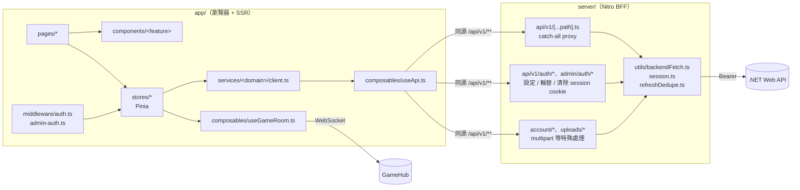

| 層 | 規則 |
|---|---|
| `pages/` | 頁面盡量薄；有多個階段的頁面（例如 `host/room/[code].vue`）拆成多個子元件 |
| `stores/` | 只用 setup-store；只有 `auth`（user）、`adminAuth`（adminUser）、`quiz`（AI 使用次數）會 persist |
| `services/<domain>/client.ts` | store 不直接呼叫 `useApi()`，一律經過 typed client |
| `useApi()` | 用 `useRequestFetch()`（SSR 才會帶上 cookie）、拆開 `ApiEnvelope<T>`、401 時去重後 refresh 一次並重試 |
| `useGameRoom()` | 單例 `HubConnection`；把 server 事件導進 `useGameStore()`；自動重連後依角色恢復房間 |
| `usePlayerSession()` | 玩家的 reconnect token 存在 `localStorage`（每個房間一份） |

主要路由：`/join`、`/join/[code]`（玩家）、`/host/room/[code]`（主持，需登入）、`/bigscreen/[code]`、`/library/*`、`/attempt/[id]`（單人作答）、`/history/*`、`/creators/[id]`、`/settings`、`/admin/*`。

---

## 5. 關鍵流程

### 5.1 REST 請求生命週期

以「更新題庫」這類寫入請求為例：

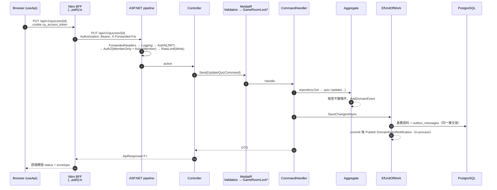

`*` `GameRoomLockBehavior` 只對實作 `IGameRoomCommand` 的命令生效。

### 5.2 認證與 Token 輪替

系統裡有**兩組 cookie**，這是最容易搞混的地方：

| Cookie | 誰發 | Domain | 誰讀 | 用途 |
|---|---|---|---|---|
| `cp_access_token` / `cp_refresh_token` | Nitro BFF（`server/utils/session.ts`） | 前端網域 | BFF | REST：BFF 轉成 Bearer / `X-Refresh-Token` |
| `cp_admin_access_token` / `cp_admin_refresh_token` | Nitro BFF | 前端網域 | BFF | 管理後台 REST |
| `access_token` / `refresh_token`（`AuthCookieNames`） | 後端（`AuthCookieExtensions`），經 BFF `forwardSetCookie` 轉給瀏覽器 | 後端網域或 `Auth:CookieDomain` | 後端 JwtBearer `OnMessageReceived` | **只給 SignalR** 用 |

Access token 壽命很短（約 60 秒）。refresh token 是**一次性輪替**，有寬限期：同一顆 token 被並行使用時，若剛被輪替且仍在寬限期內，仍然換發。

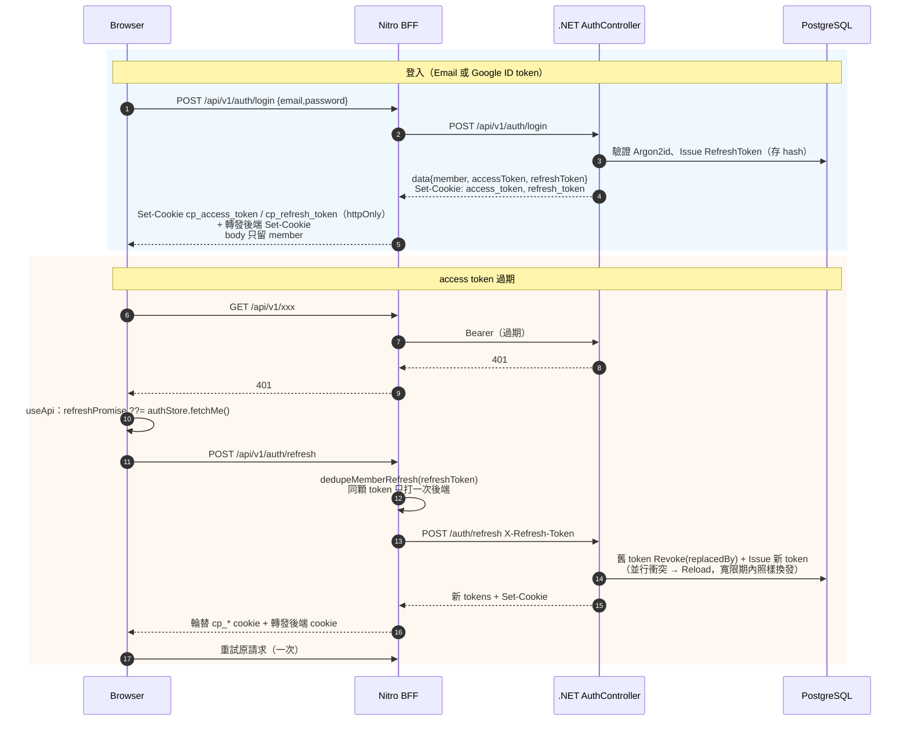

- 授權 policy：`MemberOnly`（role=member，加上 `ActiveMemberRequirement`：透過 `MemberActivityChecker` 檢查會員未刪除、未停權，結果快取 60 秒，L1 10 秒；停權 / 刪除事件會主動清掉）、`AdminOnly`。
- 停權會員在 refresh 時拿到 **401**（不是 403），讓 BFF 清掉 session。
- Host 頁面在遊戲期間由 `useGameRoom` 定時呼叫 `fetchMe()`，讓後端的 `access_token` cookie 持續被輪替，SignalR 才不會因為 cookie 過期而斷線。

### 5.3 即時遊戲完整流程

GameHub 方法與事件一覽：

| Client → Server | 權限 | 對應命令 | 廣播 |
|---|---|---|---|
| `CreateRoom(req)` | MemberOnly | `CreateRoomCommand` | Caller: `RoomCreated` |
| `JoinRoom(code, nickname)` | 匿名（有登入就記 MemberId） | `JoinRoomCommand` 🔒 | Caller: `RoomStateSync`；Room: `PlayerJoined`；回傳 `{playerId, reconnectToken}` |
| `StartGame(code)` | MemberOnly + Host | `StartGameCommand` 🔒 | Room: `GameStarted`、`QuestionStart` |
| `SubmitAnswer(code, idx)` | 已加入的玩家 | `SubmitAnswerCommand` 🔒 | Caller: `AnswerResult`；Host 群組: `AnswerProgress` |
| `SkipQuestion(code)` | MemberOnly + Host | `SkipQuestionCommand` 🔒 | Room: `QuestionEnd` / `QuestionStart` / `GameEnd` |
| `PauseGame(code)` | MemberOnly + Host | `PauseGameCommand` 🔒 | Room: `PauseStateChanged` |
| `RejoinRoom(code)` | MemberOnly + Host | `RejoinAsHostCommand` 🔒 | Caller: `RoomStateSync`；Room: `HostConnectionChanged(true)` |
| `RejoinAsPlayer(code, token)` | 匿名 | `RejoinAsPlayerCommand` 🔒 | Caller: `RoomStateSync`；Room: `PlayerReconnected` |
| `WatchRoom(code)` | 匿名 | `WatchRoomQuery` | Caller: `RoomStateSync` |
| （斷線） | — | `DisconnectHost/PlayerCommand` 🔒 | `PauseStateChanged`、`HostConnectionChanged(false)`、`PlayerLeft` / `PlayerDisconnected` |

🔒 = 實作 `IGameRoomCommand`，在 Redis 分散式鎖 `GameRoom:{code}` 內執行（讀 → 改 → 整份寫回）。

SignalR 群組：`room:{code}`（所有人）、`room:{code}:host`（只有 Host，接收 `AnswerProgress`）。

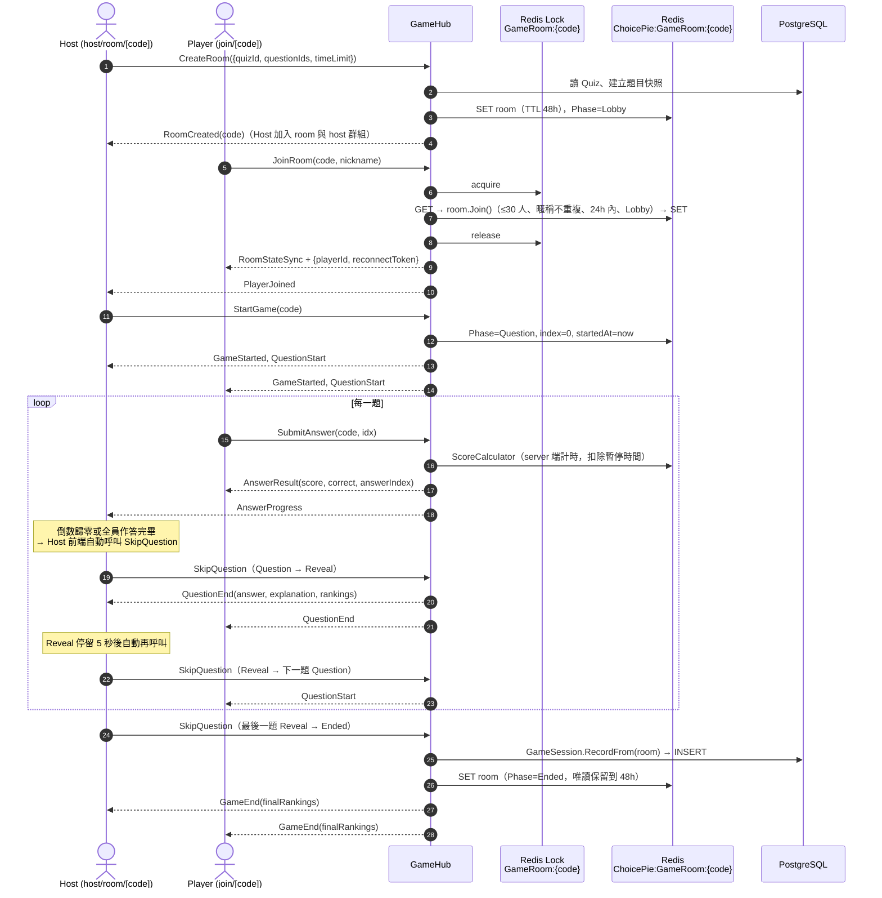

計分（`Domain/Aggregates/GameRoom/Services/ScoreCalculator.cs`）：答錯、或時間超過限制 = 0；≤3 秒 1000、≤6 秒 800、≤10 秒 600、其餘 400。可選的時間限制為 10 / 20 / 30 / 60 秒。

> **後端不自動推進題目。** 計時與推進完全由 Host 瀏覽器負責（`host/room/[code].vue` 的 watcher）；Host 離線時遊戲會自動暫停。

### 5.4 GameRoom 狀態機

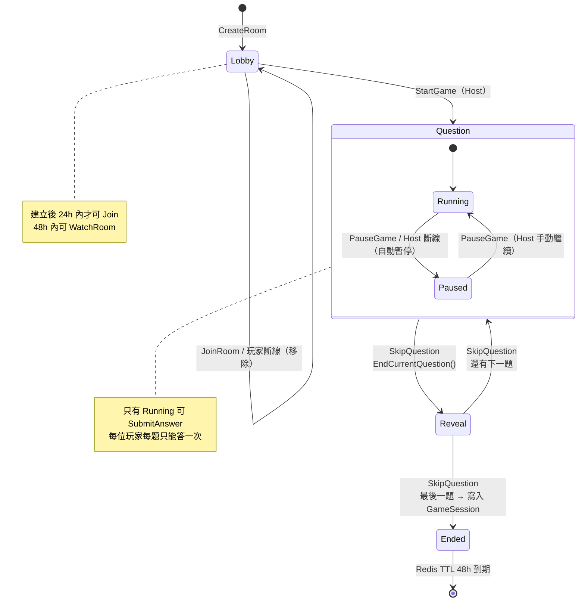

前端 `game.ts` 的 phase 是另一套命名：`idle → waiting → question → result → ended`，分別對應 Lobby / Question / Reveal / Ended。

### 5.5 斷線重連

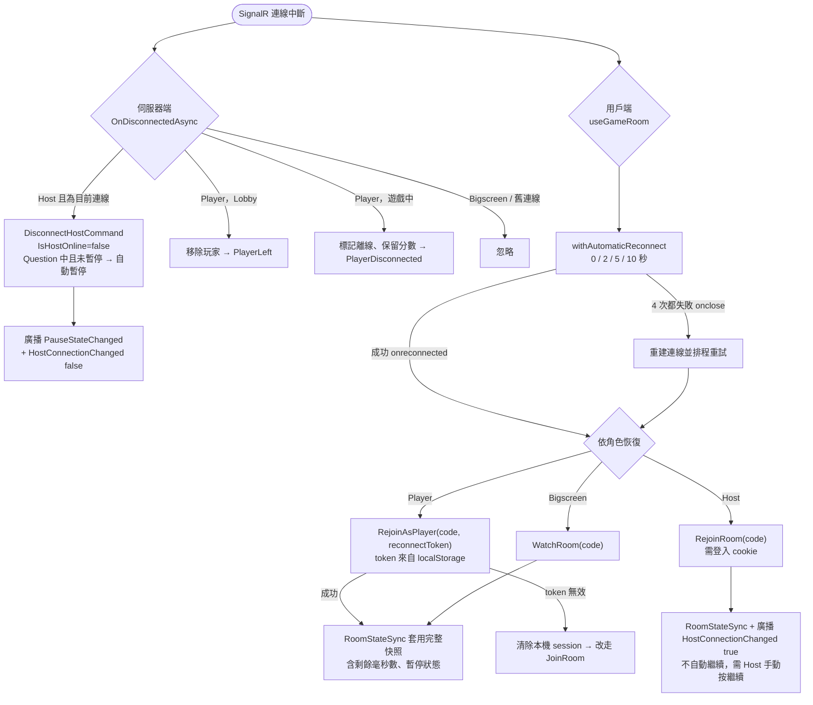

聚合用 `connectionId` 比對避免競態：快速重連後，**舊連線**晚到的斷線通知會因為 `ConnectionId` 不符而被忽略（`DisconnectPlayer` / `DisconnectHost` 回傳 `Ignored`）。

### 5.6 AI 出題

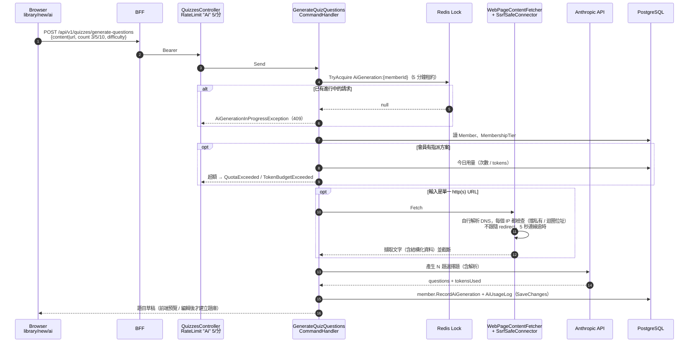

失敗發生在記錄用量**之前**（例如網頁抓不到、AI 失敗）時，不會消耗額度。

### 5.7 Domain Event 與 Transactional Outbox

事件有兩條派送路徑，依 handler 訂閱的 notification 型別決定：

| 路徑 | Handler 介面 | 何時執行 | 保證 | 用途 |
|---|---|---|---|---|
| In-process | `INotificationHandler<DomainEventNotification<T>>` | commit 後立刻在同一個請求內 `Publish` | best-effort（失敗不重試） | 清快取、寫 log |
| Reliable | `INotificationHandler<ReliableDomainEventNotification<T>>` | 寫進 outbox，由 `OutboxProcessor` 非同步派送 | at-least-once，重試 + dead letter | 寄驗證信、寄重設密碼信、帳號關閉時封存題庫、記錄挑戰結果 |

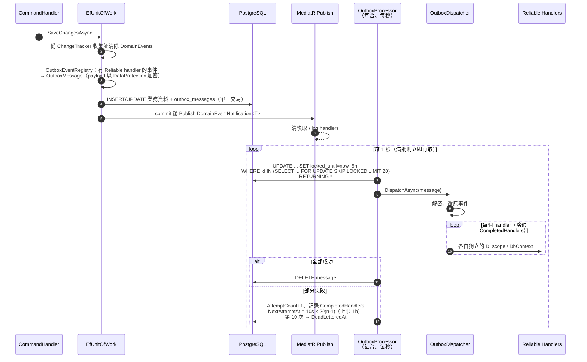

- 只補跑**失敗的 handler**（`CompletedHandlers` 記錄已成功的），所以 handler 必須能承受重送（at-least-once）。
- `GameRoom` 不經過 EF，所以它的 `GameEndedDomainEvent` 不會進入這個流程（見 known-risks）。

### 5.8 快取讀取與失效

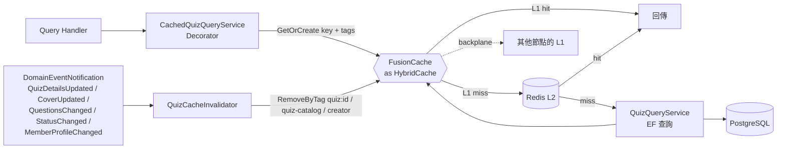

| 快取項目 | TTL（L1 = L2） | Tags |
|---|---|---|
| 題庫詳情 `GetByIdAsync` | 5 分鐘 | `quiz:{id}` |
| 作答用題庫 `GetForAttemptAsync` | 5 分鐘 | `quiz:{id}` |
| 相關題庫 `GetRelatedAsync` | 5 分鐘 | `quiz:{id}`、`quiz-catalog` |
| 標籤清單 `GetTagsAsync` | 10 分鐘 | `quiz-catalog` |
| 會員是否有效 `MemberActivityChecker` | 60 秒（L1 10 秒） | — |

全域預設：fail-safe（來源失敗時回舊值，最多 2 小時）、factory soft timeout 1 秒、Redis soft / hard timeout 1 / 2 秒（Redis 掛掉時直接查資料來源）。清單類查詢（`ListAsync`、Feed、Admin）**不快取**。作答次數、分享次數不主動失效，等 TTL 到期。

---

## 6. 資料儲存

| 資料 | 儲存位置 | 生命週期 |
|---|---|---|
| 會員、帳號、題庫、留言、收藏、追蹤、檢舉、方案、AI 用量、單人作答、遊戲歷史 `GameSession` | PostgreSQL（EF Core migrations，啟動時自動套用） | 永久；會員為軟刪除，題庫以狀態（`Deleted` / `TakenDown`）標記 |
| `outbox_messages` | PostgreSQL | 成功即刪除；失敗 10 次後成為 dead letter |
| 即時房間 `GameRoom`（`GameRoomMemento` JSON） | Redis `ChoicePie:GameRoom:{code}` | TTL 48 小時；可加入 24 小時 |
| 分散式鎖 | Redis `ChoicePie:lock:*` | 租約（房間 15 秒、AI 5 分鐘） |
| 快取 L2 | Redis `ChoicePie_*` | 依項目 TTL |
| SignalR backplane | Redis channel `ChoicePie:SignalR*` | — |
| DataProtection 金鑰環 | Redis `ChoicePie:DataProtection-Keys` | 用來加密 outbox payload；**遺失會導致 outbox 無法解密** |
| 速率限制計數 | Redis | 固定視窗 |
| 圖片（封面、頭像） | Cloudflare R2 | — |
| 玩家重連憑證 | 瀏覽器 `localStorage` | 每個房間一份 |

---

## 7. 橫切關注點

| 關注點 | 實作 |
|---|---|
| 速率限制 | Redis 固定視窗（多節點共用）。Policy：`Auth` 10/分、`Email` 5/15 分、`Ai` 5/分、`Write` 30/分、`Global` 300/分。登入者以 `sub` 分區，否則以 IP 分區。BFF 會轉發 `X-Forwarded-For`，後端只信任 `ForwardedHeaders` 設定中的 proxy |
| 例外處理 | `Shared.Hosting/Exceptions/Handlers` 轉成 `ApiResponse` envelope；Hub 由 `DomainExceptionHubFilter` 把領域例外轉成 `HubException` |
| 樂觀並行 | EF concurrency token → `ConcurrencyConflictException`；unique 違反 → `UniqueConstraintViolationException` |
| 日誌 | Serilog JSON 輸出（給 Loki，見 `choicepie-backend/docs/logging-loki.md`）、request logging、啟動前就有 bootstrap logger |
| 監控 | Sentry（前後端都是：未設定 DSN 就完全停用） |
| API 版本 | `api/v{version}/...`（Asp.Versioning） |
| API 文件 | Development 環境才有 Scalar，在 `/api-docs` |
| 安全 | Argon2id、refresh token 只存 hash、httpOnly cookie、SSRF 防護、CORS 白名單、HTML sanitizer |

---

## 8. 測試與 CI

| 範圍 | 工具 | 位置 |
|---|---|---|
| 後端單元測試 | NUnit + NSubstitute + ExpectedObjects | 每個專案都有對應的 `*.Tests` |
| 後端整合測試 | Testcontainers（Postgres / Redis）+ WebApplicationFactory | `WebApi.Tests`、`Shared.Infrastructure.Persistence.Tests` 等 |
| 前端單元測試 | Vitest + @nuxt/test-utils | `choicepie-frontend/tests/nuxt/unit/**` |
| E2E | Playwright 對多節點 Docker Compose | `e2e/`（以 `data-testid` 選取元素） |

GitHub Actions：`frontend-ci.yml`（lint / typecheck / test）、`backend-ci.yml`（build / test）、`e2e.yml`。依變更的路徑分別觸發，觸發分支為 `master`、`develop`、`feat/**`。

---

## 9. 程式碼導覽速查

| 想了解… | 從這裡開始讀 |
|---|---|
| 後端啟動與 DI | `choicepie-backend/ChoicePie.Backend/ChoicePie.Backend.WebApi/Program.cs` |
| 即時遊戲入口 | `ChoicePie.Backend.WebApi/Hubs/GameHub.cs` |
| 遊戲規則 | `ChoicePie.Backend.Domain/Aggregates/GameRoom/GameRoom.cs` |
| 房間鎖 | `ChoicePie.Backend.Application/GameRooms/GameRoomLockBehavior.cs` |
| 事件 / outbox | `ChoicePie.Backend.Shared.Infrastructure.Persistence/Repositories/EfUnitOfWork.cs`、`Outbox/*` |
| 快取 | `ChoicePie.Backend.Shared.Infrastructure.Caching/Extensions/CachingServiceCollectionExtensions.cs`、`Infrastructure/Caching/Quizzes/*` |
| AI 出題 | `ChoicePie.Backend.Application/Quizzes/Commands/GenerateQuizQuestionsCommandHandler.cs` |
| Token 輪替 | `ChoicePie.Backend.Application/Identity/Commands/RefreshTokenCommandHandler.cs` |
| BFF | `choicepie-frontend/server/api/v1/[...path].ts`、`server/utils/*` |
| 前端 REST | `choicepie-frontend/app/composables/useApi.ts` |
| 前端遊戲 | `choicepie-frontend/app/composables/useGameRoom.ts`、`app/stores/game.ts`、`app/pages/host/room/[code].vue` |
| 多節點測試環境 | `e2e/compose.yaml`、`e2e/README.md` |

---

已知限制、風險，以及文件與程式碼的落差 → **[known-risks.md](./known-risks.md)**
